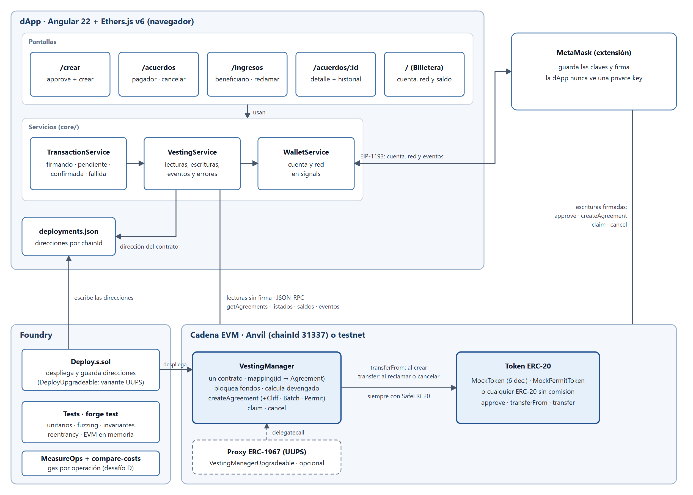
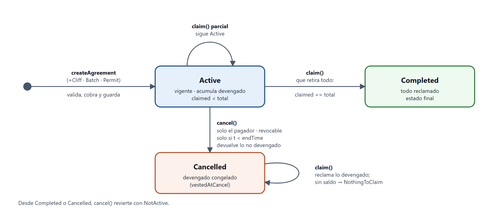

# Documento de arquitectura: Vesting dApp

**Materia:** Taller de Tecnologías 2 · **Grupo:** M6C · **Obligatorio 2026: Blockchain**
**Repositorio:** `329571-332716-326152_OblTT2` · **Integrantes:** Romina Carsin, Santiago Claveré, Renzo Macchi

## 0. Alcance y trazabilidad con la letra

Construimos una dApp que administra acuerdos de pago salarial o de vesting con un token ERC-20 sobre una red EVM: el pagador deposita el total al crear el acuerdo y el beneficiario reclama lo devengado en forma lineal entre `startTime` y `endTime`. Este documento explica cómo está resuelto y, sobre todo, **por qué elegimos cada solución** frente a las alternativas razonables.

| Sección de la letra | Qué exige | Dónde se resuelve |
|---|---|---|
| 3. Estados | `Active`, `Completed`, `Cancelled` | §2.2 |
| 4. Creación | Validaciones, `transferFrom` del total, evento | §4.1, §6 |
| 5. Vesting | Lineal, sin redondeo que pague de más | §3 |
| 6. Reclamos | Solo el beneficiario, estado antes de transferir, sin dobles reclamos | §4.2, §7 |
| 7. Cancelación | Solo revocables y antes del fin; lo devengado se conserva | §4.3 |
| 8. ERC-20 | `approve`, `allowance`, `transferFrom`, `transfer`, `SafeERC20` | §6 |
| 9. Seguridad | Los 10 puntos mínimos | §7 |
| 10. Storage/memory/calldata | Al menos 3 decisiones justificadas con código propio | §5 |
| 11. Tests | 75 % de líneas, 16 casos mínimos, tiempo reproducible | §10 |
| 12. dApp | 4 pantallas con lecturas y escrituras reales | §11 |
| 13. Documentación | Diagrama, struct, estados, fórmula, eventos, bordes, limitaciones, L1 vs L2 | todo el documento |
| 16. Desafíos opcionales | Cliff, UUPS, batch, L2, Permit | §12 |

Los números de este documento (gas, tests, cobertura) salen de la ejecución real del repositorio con Hardhat 2 y Solidity 0.8.28. Donde algo **no se midió o no se ejecutó**, lo decimos.

---

## 1. Arquitectura general

### 1.1 Diagrama de componentes



Hay dos fronteras que determinan el diseño. La primera separa **lo que firma el usuario de lo que solo lee**: las escrituras pasan siempre por MetaMask y las lecturas van directo al nodo por JSON-RPC, sin firma ni gas. La segunda separa **dónde se mueven los fondos de dónde se decide quién puede moverlos**: solo `VestingManager` habla con el token, y la dApp nunca toca un fondo ni una clave privada.

### 1.2 Responsabilidades

| Componente | Responsabilidad | Qué no hace |
|---|---|---|
| `IVestingManager` | Contrato de interfaz: struct, enums, eventos, errores y firmas. Fue lo primero que congelamos, porque desacopló el trabajo en paralelo de contratos, tests y dApp | No tiene lógica |
| `VestingManager` | Guarda todos los acuerdos, bloquea los fondos, calcula lo devengado y ejecuta creación, reclamo y cancelación | No conoce al frontend |
| `VestingManagerUpgradeable` | Variante UUPS que reutiliza toda la lógica de `VestingManager` detrás de un proxy (desafío B) | No cambia el contrato original |
| `MockToken` / `MockPermitToken` | ERC-20 de prueba con decimales configurables y `mint` abierto; el segundo agrega EIP-2612 | No se usan en producción |
| `deploy.js`, `deployUpgradeable.js` | Despliegan los contratos y escriben las direcciones por `chainId` en `frontend/public/deployments.json` | No guardan claves |
| `measureOps.js` + `compare-costs.mjs` | Ejecutan las operaciones relevantes y calculan su costo por red (desafío D) | |
| `WalletService` | Conexión con MetaMask; cuenta y red en *signals* | No habla con los contratos |
| `VestingService` | Única pieza que habla con los contratos: lecturas, escrituras, historial desde eventos y traducción de errores | No decide cuándo recargar |
| `TransactionService` | Sigue cada transacción (firmando → pendiente → confirmada o fallida) y avisa a las pantallas para que recarguen | |
| Pantallas | `/crear`, `/acuerdos`, `/ingresos`, `/acuerdos/:id`, la billetera y `TxList` (avisos de transacciones, que solo usa `TransactionService`) | No acceden a Ethers directamente |

### 1.3 Decisiones de herramientas y por qué

Dos de estas decisiones tuvieron una comparación explícita entre tecnologías; las desarrollamos con ventajas y desventajas aplicadas a **este** problema.

#### Framework de la dApp: Angular, React o Blazor WebAssembly

La letra no evalúa el framework: la dApp y la integración Web3 valen 4 de los 30 puntos de la entrega, así que el criterio fue minimizar el riesgo de aprender algo nuevo, no elegir la mejor tecnología en abstracto.

| Opción | Ventajas para este proyecto | Desventajas para este proyecto |
|---|---|---|
| **Angular** (elegida) | Estructura impuesta (servicios con inyección de dependencias), TypeScript por defecto, ruteo y formularios reactivos con validación incluidos: justo lo que necesitan `/crear` y las cuatro rutas | Más código y archivos para cuatro pantallas simples; hay pocos ejemplos de dApps en Angular |
| React + Vite | La mayor cantidad de tutoriales y ejemplos de dApps; arranca con muy poco código | La organización del proyecto y del estado queda a criterio propio; `useEffect` puede producir lecturas duplicadas o datos desactualizados |
| Blazor WebAssembly | Sería la mejor opción si el grupo dominara C# y no JavaScript | Agrega un puente entre C# y JavaScript para hablar con Ethers y otro punto donde pueden aparecer errores; es la opción con menos material |

**Qué decidimos y por qué.** Angular, por el criterio del plan: usar el framework que ya manejaba la persona responsable de la dApp. Las dos piezas de Angular que más pesaron fueron los **servicios con inyección de dependencias** (la lógica de billetera, contratos y transacciones queda en tres servicios con una responsabilidad cada uno, §11) y los **formularios reactivos** con validadores propios (dirección válida, fechas coherentes con la hora de la cadena). Dejamos acordado un plan B: si la prueba mínima de MetaMask no funcionaba para el 3/11, se evaluaba pasar a React. No hizo falta.

#### Entorno de tests y deploy: Hardhat

Usamos Hardhat, el mismo entorno de la clase 13: tests en JavaScript con Mocha y Chai, `loadFixture` y los *matchers* de Hardhat. Cumple todo lo que exige la letra: manipular el tiempo de forma reproducible, medir cobertura y probar reentrancy. Como la estructura de los tests es la que vimos en clase, cada caso de la letra se puede explicar con las mismas herramientas (§10.1).

| Necesidad | Cómo la resolvemos |
|---|---|
| Lenguaje de los tests | JavaScript (Mocha + Chai + Ethers v6) |
| Estado limpio en cada test | `loadFixture` |
| Errores y eventos | `revertedWithCustomError` y `emit(...).withArgs(...)` |
| Tiempo | `time.setNextBlockTimestamp` (`hardhat-network-helpers`) |
| Cobertura | `npx hardhat coverage` (solidity-coverage) |
| Atacantes (reentrancy, token con comisión) | Contratos Solidity en `src/mocks/` (`ReentrantToken`, `FeeToken`), orquestados desde los tests |
| Entradas aleatorias e invariantes | Bucles con generador pseudoaleatorio de semilla fija (reproducibles), porque Hardhat no trae fuzzing nativo |

**Qué hay que tener en cuenta.** Hardhat no trae fuzzing ni invariantes nativos, así que los escribimos nosotros: recorren entradas pseudoaleatorias con semilla fija y verifican las propiedades después de cada paso (§10.3). Es menos potente que un *fuzzer* con minimización de casos, pero es reproducible y cubre los puntos de la sección 9 de la letra que son difíciles de cubrir con casos fijos (redondeo, «reclamar más de lo depositado», «el balance del contrato cubre lo pendiente»). La red en memoria de Hardhat se configura con `allowBlocksWithSameTimestamp`, para poder mirar el estado en el segundo X y enviar una transacción exactamente en X; sin eso no se podrían probar los límites «justo en `endTime`».

#### Blockchain local, billetera y librería

- **Nodo local de Hardhat** (`npm run node`): lo usamos porque se puede configurar para minar un bloque por segundo y mover el reloj con `evm_increaseTime`. Con minado solo por transacción, `block.timestamp` queda fijo y el devengado «no avanza» en la demo. Es consecuencia directa de que la letra define el vesting en función del tiempo. Usa el chainId 31337 y las mismas cuentas de prueba públicas de siempre, por lo que las direcciones del deploy no cambian.
- **MetaMask** y **Ethers.js v6**: MetaMask es la billetera EVM de uso general que pide la sección 12. Ethers devuelve montos como `bigint`; la dApp convierte con `formatUnits`/`parseUnits` usando los `decimals()` del token y nunca asume 18.
- **Sin dependencias fuera de npm**: Hardhat y OpenZeppelin se instalan con `npm install` dentro de `contracts/`, con la versión de OpenZeppelin fija en `package.json`. No hace falta instalar ninguna herramienta aparte ni usar WSL: alcanza con Node.js en cualquier terminal.
- **Remix**: no lo usamos. Los tests, la cobertura y el deploy quedan en Hardhat, para que el único camino reproducible sea el del repositorio.

### 1.4 Un contrato para todos los acuerdos, no uno por acuerdo

Ya estaba decidido en el plan y lo sostenemos porque la sección 2 de la letra define el escenario como una organización que paga a **muchos** beneficiarios.

| Opción | Ventajas | Desventajas aplicadas a nuestro caso |
|---|---|---|
| **Un contrato con `mapping(id => Agreement)`** (elegida) | Crear un acuerdo cuesta solo storage (≈206 000 gas el segundo `createAgreement`); una sola dirección para la dApp; listados y lecturas en lote simples | Un solo contrato concentra todos los fondos: el aislamiento entre acuerdos depende por completo de la contabilidad interna |
| Un contrato por acuerdo (*factory*) | Aislamiento total de fondos entre acuerdos | Cada acuerdo implica desplegar bytecode completo, varias veces más caro que escribir 6 slots; la dApp debería descubrir direcciones nuevas; el batch payroll (desafío C) perdería sentido |
| Clones mínimos (ERC-1167) por acuerdo | Despliegue barato (unos 45 bytes de código por clon) | Sigue habiendo una creación de contrato por acuerdo y una capa más de indirección que explicar en la defensa |

**Por qué.** La contabilidad interna es chica y verificable: reclamado ≤ devengado ≤ total por acuerdo, y balance del contrato ≥ suma de lo pendiente. Ese invariante lo comprobamos con un test de propiedades (§10.3), que es lo que compensa el riesgo de concentrar los fondos.

---

## 2. Modelo de datos

### 2.1 Estructura de un acuerdo

```solidity
struct Agreement {
    address payer;        // slot 1
    uint48  startTime;    // slot 1
    uint48  endTime;      // slot 1
    address beneficiary;  // slot 2
    Status  status;       // slot 2 (1 byte)
    bool    revocable;    // slot 2 (1 byte)
    address token;        // slot 3
    uint256 totalAmount;     // slot 4
    uint256 claimedAmount;   // slot 5
    uint256 vestedAtCancel;  // slot 6
}
```

| Slot | Contenido | Bytes usados |
|---|---|---|
| 1 | `payer` + `startTime` + `endTime` | 20 + 6 + 6 = **32** (lleno) |
| 2 | `beneficiary` + `status` + `revocable` | 20 + 1 + 1 = 22 |
| 3 | `token` | 20 |
| 4 – 6 | `totalAmount`, `claimedAmount`, `vestedAtCancel` | 32 c/u |

Con todos los campos en 32 bytes serían **10 slots**; empaquetados son **6**. El orden de los campos no es arbitrario: los tres del slot 1 suman exactamente 32 bytes, y los dos campos chicos (`status`, `revocable`) viajan en el slot de `beneficiary` en lugar de ocupar uno propio.

**Por qué `uint48` para las fechas.** Un `uint48` representa segundos hasta el año ~8,9 millones: sobra para un `block.timestamp`, y es lo que permite que dos fechas entren junto a una dirección en un único slot.

**Estructuras auxiliares.**

- `AgreementSummary { agreement, vested, claimable }`: lo que devuelve `getAgreements`. Existe porque la dApp necesitaba el devengado de cada acuerdo y, sin él, debía hacer tres llamadas por acuerdo (§5.5).
- `PermitSignature { deadline, v, r, s }`: la firma EIP-2612 del pagador, en `calldata`.
- Mappings: `_agreements`, `_idsByPayer`, `_idsByBeneficiary` y `_cliffTime`.

**Dos decisiones del modelo que merecen justificación.**

1. **Ids desde 1.** El acuerdo «no existe» se detecta con `payer == address(0)`. Como la letra pide que cada acuerdo tenga un identificador único, empezar en 1 evita que el id `0` (el valor por defecto de una variable no inicializada o de un `id` mal pasado) se confunda con un acuerdo válido.
2. **`Completed` se guarda, no se deriva.** Podría deducirse de `claimedAmount == totalAmount`, pero la letra lo nombra como estado y guardarlo tiene dos ventajas: la dApp lo lee directo de `status` y `cancel` rechaza un acuerdo terminado con una única comparación (`NotActive`). El costo es una escritura extra, solo en el último reclamo.

### 2.2 Máquina de estados



| Transición | Quién y cuándo | Si no se cumple |
|---|---|---|
| (nada) → `Active` | `createAgreement` (y sus variantes) con parámetros válidos y fondos cobrados | `ZeroAddress`, `InvalidBeneficiary`, `ZeroAmount`, `InvalidTimeRange`, `InvalidCliff`, `FeeOnTransferNotSupported`, errores del token |
| `Active` → `Completed` | `claim` del beneficiario que deja `claimedAmount == totalAmount` | — |
| `Active` → `Cancelled` | `cancel` del pagador, solo si es revocable y `t < endTime` | `NotPayer`, `NotActive`, `NotRevocable`, `AlreadyEnded` |
| `Cancelled` → `Cancelled` | `claim` del beneficiario sobre lo devengado hasta la cancelación | `NothingToClaim` cuando ya no queda saldo |

Dos decisiones de la máquina que no son obvias:

- **Un acuerdo cancelado nunca pasa a `Completed`**, aunque el beneficiario retire todo lo devengado. Mantener `Cancelled` conserva la información de que el pagador interrumpió el acuerdo, que es lo que muestra el historial y lo que explica por qué el total no coincide con lo reclamado.
- **Un acuerdo cuyo `endTime` ya pasó sigue `Active` hasta el último reclamo.** Es lo que habilita que el beneficiario retire en cualquier momento y que no haga falta una transacción de «cierre».

El orden de las verificaciones en `cancel` es: pagador, estado, revocable y fecha. Va así para que un tercero reciba siempre `NotPayer` y no obtenga información sobre el acuerdo.

---

## 3. Fórmula de vesting

```
t < cliff (si hay)            -> 0
t <= startTime                -> 0
startTime < t < endTime       -> total * (t - startTime) / (endTime - startTime)
t >= endTime                  -> total
```

`claimable = vested - claimed`. Una vez cancelado, `vested` queda congelado en `vestedAtCancel`.

### 3.1 Cómo calculamos la proporción y por qué

La letra exige «evitar errores de redondeo que permitan reclamar más tokens que los depositados». Es el único requisito numérico del modelo y condiciona la fórmula.

| Enfoque | Ventajas | Desventajas aplicadas a nuestro caso |
|---|---|---|
| `(t - start) / (end - start) * total` (dividir antes) | Ninguna | En enteros el cociente es siempre 0 o 1: el devengado sería 0 hasta el final y luego todo. Inutilizable |
| `total / duración * transcurrido` (tasa por segundo) | Simple de explicar | Pierde el resto de `total / duración` en cada segundo. Con 7 unidades en 3 segundos la tasa es 2 y al final se habrían pagado 6, no 7: **habría que parchear el último tramo** y quedaría polvo atrapado |
| `total * transcurrido / duración` con `*` y `/` nativos | Exacto y barato | `total * transcurrido` puede desbordar `uint256` con montos muy grandes y revertir, bloqueando reclamos |
| **`Math.mulDiv(total, transcurrido, duración)`** (elegida) | Multiplica primero con 512 bits intermedios (sin desborde), redondea hacia abajo, ya está auditada | Una dependencia más (OpenZeppelin, que ya usamos) |

**Por qué `mulDiv`.** Es la única opción que es a la vez exacta, sin desborde y de una línea. Redondear hacia abajo es lo que garantiza la propiedad pedida: el devengado nunca supera lo proporcional y, al llegar `t >= endTime`, la fórmula devuelve exactamente `total`, por lo que **la suma de todos los reclamos de un acuerdo es siempre igual al depósito, sin polvo**. Lo comprobamos con fuzzing (`testFuzz_manyPartialClaimsNeverExceedDeposit`: muchos reclamos parciales, depósito entre 1 y 10¹² unidades, duración hasta 3 años) y con casos de borde:

| Caso | Resultado |
|---|---|
| 7 unidades en 3 s | devengado 2, 4 y 7 en cada segundo |
| 1 unidad durante 1 año | 0 hasta el último segundo y 1 al final |
| `uint128.max` como monto | sin desborde |

### 3.2 Cliff

El cliff (desafío A) anula el devengado antes de `cliffTime`. **Desde el cliff rige el lineal calculado desde `startTime`, no desde el cliff**, porque así lo describe la letra: «luego del cliff deberá respetarse el esquema de vesting definido». Con `startTime = 0`, `cliff = 300` y `endTime = 1000`, en `t = 300` ya hay 300 devengados, no 0.

**Cliff en un mapping aparte.** Para guardar el cliff comparamos dos diseños:

| Opción | Ventajas | Desventajas aplicadas a nuestro caso |
|---|---|---|
| Campo `cliffTime` en el struct `Agreement` | Un único lugar con todo el acuerdo | Cambia el ABI de `getAgreement`, de `getAgreements` y la decodificación del frontend, que ya estaba integrado y probado |
| **`mapping(uint256 => uint48) _cliffTime`** (elegida) | El struct, `AgreementCreated` y todas las firmas que usa la dApp **no cambian** | Una lectura de storage adicional (`SLOAD`) al calcular el devengado; el cliff se consulta con `cliffOf(id)` |

Elegimos el mapping porque el cambio era opcional y el frontend es de otra persona: un cambio aditivo no puede romper lo que ya funcionaba.

---

## 4. Flujos

### 4.1 Creación

El orden dentro de `createAgreement` es validar → cobrar → guardar, implementado en tres funciones internas (`_validate`, `_pull`, `_store`) que comparten todas las variantes de creación (cliff, batch y Permit).

**Validaciones** (todas antes de mover fondos): beneficiario distinto de `address(0)`, monto mayor a cero y `endTime > startTime` vienen de la sección 4 de la letra. Agregamos dos propias: token distinto de cero y beneficiario distinto de `address(this)`.

Dos decisiones que la letra deja abiertas o no cubre:

- **Rechazar `address(this)` como beneficiario.** Si el contrato fuera beneficiario, nadie podría reclamar nunca y esos fondos quedarían trabados para siempre. Es una validación de un `if` que evita un error de usuario irrecuperable.
- **Permitir una fecha de inicio pasada, pero exigir `endTime` futuro.** Permitirla habilita el caso real de «pagar con efecto retroactivo» (por ejemplo, un acuerdo que debió empezar el mes pasado) y en una demo permite crear un acuerdo con devengado inmediato. Exigir `endTime > block.timestamp` evita crear un acuerdo que ya nace terminado, que no tendría sentido como flujo de pago. La letra no lo define, así que lo documentamos.

### 4.2 Reclamo

```solidity
function claim(uint256 id) external nonReentrant {
    Agreement storage a = _getStorage(id);
    if (msg.sender != a.beneficiary) revert NotBeneficiary();

    uint256 amount = _vested(id, a) - a.claimedAmount;
    if (amount == 0) revert NothingToClaim();

    a.claimedAmount += amount;                       // efectos
    if (a.status == Status.Active && a.claimedAmount == a.totalAmount) {
        a.status = Status.Completed;
    }
    emit Claimed(id, msg.sender, amount);

    IERC20(a.token).safeTransfer(msg.sender, amount); // interacción, al final
}
```

El reclamo calcula el monto, **actualiza el estado y emite el evento antes de transferir**, que es el requisito explícito de la sección 6 de la letra. No hay forma de reclamar dos veces lo mismo porque `claimedAmount` ya subió cuando sale el token. El mismo código sirve para un acuerdo cancelado: `_vested` devuelve el valor congelado, así que no hace falta una función aparte.

### 4.3 Cancelación

La letra dice que al cancelar «lo ya devengado permanece a favor del beneficiario y lo no devengado vuelve al pagador». Había tres formas de cumplirlo:

| Opción | Ventajas | Desventajas aplicadas a nuestro caso |
|---|---|---|
| Pagar al beneficiario y al pagador en la misma transacción (*push*) | El estado final es inmediato | Si el beneficiario es un contrato que revierte al recibir o un token con bloqueo de direcciones, **bloquea la cancelación del pagador**. Además agrega una transferencia externa más dentro de `cancel` |
| Eliminar el acuerdo y devolver todo | Sencillo | Incumple la letra: borra lo devengado a favor del beneficiario |
| **Congelar lo devengado y que el beneficiario lo reclame** (*pull*, elegida) | El pagador siempre puede cancelar; una sola transferencia dentro de `cancel` (el reembolso); reutiliza `claim` | El beneficiario debe hacer una transacción para cobrar lo devengado, y por eso paga ese gas |

Por esa razón elegimos *pull*: es el único diseño en el que un beneficiario malicioso o defectuoso no puede impedir la cancelación. El efecto práctico:

```solidity
uint256 vested = _linearVested(a.totalAmount, a.startTime, _cliffTime[id], a.endTime);
uint256 refund = a.totalAmount - vested;
a.status = Status.Cancelled;
a.vestedAtCancel = vested;                // el beneficiario conserva esto
...
if (refund > 0) IERC20(a.token).safeTransfer(a.payer, refund);
```

`refund + vestedAtCancel == totalAmount` siempre, así que el contrato no crea ni pierde tokens al cancelar (lo prueba `testFuzz_cancelSplitsExactlyTheDeposit`). Cancelar **antes de `startTime`** (o del cliff) devuelve todo al pagador, porque el devengado es 0; cancelar **en `endTime` o después** revierte con `AlreadyEnded`, como pide la letra («antes de su finalización»).

---

## 5. Storage, memory y calldata

La letra pide justificar al menos tres decisiones con ejemplos del propio código. Documentamos seis.

### 5.1 Struct empaquetado (storage)

Ver §2.1. **Impacto:** `createAgreement` escribe 6 slots en vez de 10. Cada `SSTORE` a un slot que estaba en cero cuesta unos 20 000 gas, y es la operación dominante de la creación; empaquetar es lo que baja ese costo. Medimos 262 297 gas el primer `createAgreement` y 206 197 el segundo (algunos slots, como el balance del contrato en el token, ya no están en cero). Una ventaja secundaria: `payer`, `startTime` y `endTime` se leen con un único `SLOAD`.

### 5.2 Puntero a storage en lugar de copia

```solidity
function _getStorage(uint256 id) private view returns (Agreement storage a) {
    a = _agreements[id];
    if (a.payer == address(0)) revert AgreementNotFound();
}
```

`Agreement storage a` es una referencia: no copia nada y solo se lee, con `SLOAD`, lo que realmente se usa. Con `Agreement memory a` se copiarían los 6 slots a memoria aunque `claim` use dos campos. Además solo con el puntero se puede escribir (`a.claimedAmount += amount`), cosa que una copia en memoria no permite.

### 5.3 Memory en las lecturas para la dApp

`getAgreement` devuelve `Agreement memory`: una función `external view` no puede devolver un puntero a storage, así que la copia es obligatoria. Es el único lugar donde pagamos la copia completa y, como es `view`, no cuesta gas a quien lo consulta desde la dApp.

### 5.4 Calldata en las lecturas y escrituras de lote

```solidity
function getAgreements(uint256[] calldata ids) external view returns (AgreementSummary[] memory result)
function createAgreementsBatch(address token, address[] calldata beneficiaries,
                               uint256[] calldata amounts, ...) external ...
function createAgreementWithPermit(..., PermitSignature calldata sig) external ...
```

`calldata` solo sirve para parámetros dinámicos (arreglos, `bytes`, `string`, structs) de funciones `external`, y evita copiarlos a memoria porque se leen directo de los datos de la transacción. Es el caso del arreglo de ids de `getAgreements`, de los dos arreglos del batch (de largo arbitrario) y de la firma de Permit. Las demás funciones reciben solo tipos por valor (`address`, `uint256`, `uint48`, `bool`), que no llevan ubicación de datos.

El contraste está en `MockToken`: su constructor recibe `string memory name_`. En un constructor los parámetros dinámicos **deben** ir en `memory`, porque `calldata` no existe fuera de las funciones `external`.

**Qué nos obligó a usar `calldata` con código propio.** Al revisar este requisito vimos que el contrato original no tenía ningún parámetro dinámico, y por lo tanto ningún ejemplo de `calldata` para mostrar. La lectura en lote `getAgreements` resolvió ese hueco y, a la vez, un problema real de la dApp (§5.5).

### 5.5 Lectura en lote en una sola llamada

Para listar acuerdos, la dApp necesitaba el acuerdo, lo devengado y lo disponible de cada uno. Con las funciones originales eran **tres llamadas por acuerdo** (`getAgreement`, `vestedAmount`, `claimableAmount`). Con `getAgreements` es **una llamada para todos**.

Hubo dos diseños para el valor de retorno:

| Opción | Ventajas | Desventajas aplicadas a nuestro caso |
|---|---|---|
| `Agreement[]` (primera versión) | Reutiliza el struct existente | La dApp seguiría necesitando `vestedAmount` y `claimableAmount` por acuerdo: no resolvía el problema de las llamadas |
| **`AgreementSummary[]`: acuerdo + `vested` + `claimable`** (adoptada) | Un listado completo en una llamada; el cálculo corre una sola vez, en el contrato | Un struct más en la interfaz |

Adoptamos la segunda porque era la que la dApp ya consumía y la que ataca el problema original. Lo dejamos escrito porque el cambio apareció al integrar: dos personas agregaron `getAgreements` en paralelo con retornos distintos y al unir las ramas el contrato dejaba de compilar.

### 5.6 Arreglos de ids para los listados y eventos para el historial

`_idsByPayer` y `_idsByBeneficiary` guardan solo ids (32 bytes por acuerdo): el acuerdo completo se lee aparte. El **historial no se guarda en storage**, se reconstruye con eventos, que son más baratos que escribir storage y suficientes para la pantalla de detalle. Las alternativas eran guardar el historial on-chain (caro y sin consumidor on-chain) o no listar por cuenta (obligaría a la dApp a recorrer todos los eventos).

---

## 6. ERC-20 y manejo de tokens

### 6.1 Qué hace cada llamada del estándar en nuestro flujo

| Llamada | Para qué la usamos |
|---|---|
| `approve(spender, monto)` | El pagador autoriza al `VestingManager` a mover su token. Es obligatorio **antes** de crear, porque el contrato toma los fondos él mismo |
| `allowance(owner, spender)` | La dApp la lee para decidir si hace falta `approve` o si ya alcanza (`needsApproval`) |
| `transferFrom(pagador, contrato, monto)` | `createAgreement` bloquea el total; es la razón de que existan dos transacciones al crear |
| `transfer(destino, monto)` | El contrato paga en `claim` y reembolsa en `cancel` |

### 6.2 `SafeERC20` en lugar de llamadas directas

Usamos siempre `safeTransfer` y `safeTransferFrom`.

| Opción | Ventajas | Desventajas aplicadas a nuestro caso |
|---|---|---|
| `IERC20(token).transfer(...)` directo | Un poco menos de gas | Algunos tokens (el caso conocido es USDT) **no devuelven `bool`** y otros devuelven `false` sin revertir: con la llamada directa, o revierte sin motivo, o el contrato da por buena una transferencia que no ocurrió y marca un reclamo como pagado |
| **`SafeERC20`** (elegida) | Verifica el resultado y revierte si la transferencia falló; soporta tokens que no devuelven valor | Algo más de gas por una verificación |

**Por qué.** El contrato acepta **cualquier** ERC-20 (el token es un parámetro por acuerdo y un campo libre en `/crear`) y la letra pide pagos con un token estable. No controlamos el código del token, y una transferencia silenciosamente fallida desembocaría en dinero marcado como pagado que nunca salió.

### 6.3 Tokens con comisión por transferencia: revertir, no acreditar lo recibido

El contrato mide el balance antes y después del `transferFrom` y revierte con `FeeOnTransferNotSupported` si no coincide con el monto pedido.

| Opción | Ventajas | Desventajas aplicadas a nuestro caso |
|---|---|---|
| **Revertir** (elegida) | El total declarado del acuerdo es siempre el total realmente bloqueado; el devengado y todos los invariantes siguen valiendo | No soporta tokens con comisión |
| Acreditar lo realmente recibido | Soporta más tokens | El `totalAmount` pasa a depender de un detalle del token, el beneficiario cobraría menos de lo que ve el pagador y habría que explicarlo en cada pantalla |

La letra define un acuerdo con «monto total» fondeado completo al crearse, y la dApp muestra ese total: aceptar una diferencia silenciosa rompe esa promesa. Además un token con comisión también rompería el pago final (`transfer` entregaría menos que el devengado). Lo probamos con `FeeToken` (comisión del 1 %).

### 6.4 Permit (EIP-2612)

`createAgreementWithPermit` permite crear un acuerdo con **una** transacción: el pagador firma un mensaje fuera de la cadena y el contrato llama a `permit` y luego cobra. Ahorra la transacción de `approve`.

La decisión de seguridad clave es llamar a `permit` dentro de un `try/catch`:

```solidity
try IERC20Permit(token).permit(msg.sender, address(this), amount, sig.deadline, sig.v, sig.r, sig.s) {}
catch {}
_pull(token, amount);  // revierte con ERC20InsufficientAllowance si no hay allowance
```

La firma viaja visible en el *mempool*: cualquiera puede ejecutar `token.permit(...)` antes que nosotros. Sin `try/catch`, esa llamada adelantada haría revertir la creación (ataque de *griefing*: no roba nada pero bloquea al usuario). Con el `try/catch`, el fallo del `permit` se ignora y el cobro funciona igual porque la allowance ya quedó otorgada. El mismo mecanismo hace que un token sin soporte de Permit siga funcionando si el pagador ya hizo `approve`. Se aprueba exactamente `amount`, de modo que el `transferFrom` consume toda la allowance y no queda una aprobación abierta.

---

## 7. Seguridad

### 7.1 Los diez puntos de la letra

| Punto de la sección 9 | Medida | Test que lo demuestra |
|---|---|---|
| Control de acceso | `msg.sender` contra `beneficiary` o `payer` | describe Reclamos («solo el beneficiario puede reclamar») y describe Cancelación («solo el pagador puede cancelar») |
| Doble reclamo | `claimable = vested − claimed`; tras reclamar `claimed` sube | Reclamos: «un segundo reclamo en el mismo instante revierte con NothingToClaim», «reclamar despues de haber retirado todo revierte» |
| Cancelación no autorizada | `NotPayer` | Cancelación: «solo el pagador puede cancelar (ni un tercero ni el beneficiario)» |
| Cancelación de no revocables | `NotRevocable` | Cancelación: «un acuerdo no revocable no se puede cancelar» |
| Reclamos antes del inicio | Devengado 0, `NothingToClaim` | Reclamos: «reclamar antes del inicio revierte», «reclamar exactamente en el inicio revierte» |
| Reclamos posteriores a una cancelación | `vestedAtCancel` congelado, `claim` lo respeta | Cancelación: «lo devengado queda congelado y el beneficiario lo puede reclamar despues», «con un reclamo parcial previo, lo disponible es devengado menos reclamado» |
| Valores de tiempo inválidos | `InvalidTimeRange`, `InvalidCliff`, `AlreadyEnded` | Creación: «revierte con tiempos invalidos»; Cancelación: «cancelar exactamente en el fin revierte con AlreadyEnded» |
| Redondeos | `mulDiv` hacia abajo | describe Redondeo, entradas aleatorias e invariantes |
| Reentrancy o token malicioso | `nonReentrant` + estado antes de transferir | describe Reentrancy (4 ataques) |
| Validación de parámetros | `_validate` antes de cualquier transferencia | Creación: «revierte con parametros invalidos»; `VestingBatch.test.js` |

### 7.2 Reentrancy: dos defensas a la vez

| Opción | Cuando alcanza | Cuando no alcanza |
|---|---|---|
| Solo *checks-effects-interactions* | Protege `claim` y `cancel` si el orden se respeta siempre | Depende de que nadie rompa el orden en un cambio futuro; no cubre `createAgreement`, donde el cobro con `transferFrom` ocurre antes de guardar el acuerdo |
| Solo `nonReentrant` | Bloquea cualquier reentrada | Si alguna vez se omite el modificador, no queda nada |
| **Ambas** (elegida) | La segunda capa cubre el olvido de la primera | Un poco más de gas por la guarda |

El diseño cumple los dos requisitos de la letra («el monto ya reclamado deberá actualizarse antes de realizar transferencias externas» y reentrancy como riesgo explícito). **Cómo lo probamos:** un `ReentrantToken` intenta reentrar durante la transferencia. Los cuatro escenarios están pensados para que la reentrada **pase los chequeos de acceso**, de modo que solo la guarda pueda detenerla: el token es a la vez pagador y beneficiario. Los cuatro fallan con `ReentrancyGuardReentrantCall` y los fondos se cobran una sola vez (`claim` reentra `claim`, `cancel` reentra `cancel`, `cancel` reentra `claim` y `createAgreement` reentra `createAgreement`).

### 7.3 Control de acceso: comparaciones directas, no roles

Usamos `msg.sender == a.beneficiary` / `a.payer` en lugar de `Ownable` o `AccessControl` de OpenZeppelin. Los permisos de este sistema son **por acuerdo** (cada uno tiene su pagador y su beneficiario), no globales: un rol global como «administrador» no representaría nada y, además, agregaría un actor con poder sobre todos los fondos, que el diseño no necesita. Solo la variante UUPS tiene un `owner`, y únicamente para autorizar upgrades (§12).

### 7.4 Errores personalizados

La letra prefiere custom errors a strings de revert. Además de eso, en este contrato aportan dos cosas concretas: el costo en gas y en bytecode es menor que el de un `revert("texto")` (un selector de 4 bytes contra una cadena ABI-codificada), y la dApp los decodifica por nombre y los traduce al español, en lugar de mostrar un mensaje técnico del nodo.

### 7.5 Dependencia del tiempo

La letra define todo en función del tiempo y el contrato usa `block.timestamp`, que el productor del bloque puede desplazar por unos segundos. Es aceptable porque la escala del vesting son días o meses y una desviación de segundos mueve el devengado en una fracción insignificante del total. Es el aviso típico de un linter (`block-timestamp`); está revisado y es inherente al requisito.

La dApp, por la misma razón, calcula el progreso con la **hora del último bloque** (`chainTime`) y nunca con `Date.now()`: sin eso, tras adelantar el reloj de la cadena local las fechas y el devengado mostrados no coincidirían con los que valida el contrato.

### 7.6 Avisos del linter

El compilador de Hardhat no emite avisos, pero un linter de Solidity (por ejemplo el de Foundry) suele marcar tres puntos: `block-timestamp`, `reentrancy-events` e `incorrect-strict-equality`. Los tres están revisados a mano: el primero es inherente al requisito; el segundo no aplica porque las funciones que emiten cerca de una llamada externa están protegidas con `nonReentrant`; el tercero es `claimedAmount == totalAmount`, la condición exacta de «completado».

---

## 8. Eventos

| Evento | Campos (`indexed` marcados) | Cuándo | Para qué |
|---|---|---|---|
| `AgreementCreated` | `id` (indexed), `payer` (indexed), `beneficiary` (indexed), `token`, `totalAmount`, `startTime`, `endTime`, `revocable` | Al crear (uno por acuerdo, también en batch) | Primer evento del historial; la dApp saca el `id` del recibo |
| `Claimed` | `id` (indexed), `beneficiary` (indexed), `amount` | En cada reclamo | Historial; el último marca el paso a `Completed` |
| `AgreementCancelled` | `id` (indexed), `payer` (indexed), `refundedToPayer`, `vestedAtCancel` | Al cancelar | Historial; deja registrado el reparto exacto |
| `CliffConfigured` | `id` (indexed), `cliffTime` | Solo si el acuerdo tiene cliff, tras `AgreementCreated` | Que el historial pueda mostrar el cliff sin cambiar `AgreementCreated` |

**Por qué estos campos indexados.** `id` está indexado en los cuatro para que la pantalla de detalle pida el historial de un acuerdo filtrando por tópico en lugar de recorrer todos los eventos. `payer` y `beneficiary` en `AgreementCreated` permiten buscar los acuerdos de una cuenta desde afuera de la cadena, aunque la dApp usa las listas del contrato.

**El paso a `Completed` no tiene evento propio.** Un evento aparte no aportaría información que no esté en el último `Claimed`, y cada evento extra suma gas a la operación más frecuente del sistema. Lo dejamos documentado como decisión consciente. La letra pide «eventos en las transiciones importantes»: la transición queda cubierta por `Claimed`.

---

## 9. Casos de borde

| Caso | Comportamiento y por qué |
|---|---|
| Reclamar o cancelar antes de `startTime` | Reclamar: `NothingToClaim`. Cancelar: devuelve todo al pagador |
| `t == startTime` exacto | Devengado 0 (la condición es `t <= startTime`); no hay saltos en el límite |
| `t == endTime` exacto | Devengado = total, y `cancel` revierte con `AlreadyEnded`: se prueba el límite exacto además de antes y después |
| Reclamar tras cancelar | Funciona por `vestedAtCancel − claimed`; revierte con `NothingToClaim` cuando no queda |
| Cancelar con reclamos parciales previos | El reembolso es `total − devengado`; el beneficiario conserva `devengado − ya reclamado` |
| Cancelar un acuerdo `Completed` o ya `Cancelled` | `NotActive` |
| Monto de 1 unidad o 7 en 3 segundos | Redondeo hacia abajo, sin polvo al final (§3.1) |
| Monto enorme (`uint128.max`) | `mulDiv` no desborda |
| Cliff igual a `startTime` o a `endTime` | Permitido; con `cliff == endTime` el acuerdo es «todo o nada» |
| Cliff `0` explícito en `createAgreementWithCliff` | Rechazado con `InvalidCliff`; para «sin cliff» se usa `createAgreement` |
| Pagador igual al beneficiario | Permitido: es válido y es lo que usa `measureOps.js` |
| Mismo beneficiario repetido en un batch | Permitido; crea dos acuerdos independientes |
| Batch con un elemento inválido | Revierte **todo** y no mueve fondos: se valida todo el lote antes de transferir |
| Permit con firma vencida, repetida o de otro monto | `permit` falla en silencio y el cobro falla con `ERC20InsufficientAllowance`; nunca se crea un acuerdo sin fondos |
| Token con comisión | `FeeOnTransferNotSupported` |
| Id inexistente o `0` | `AgreementNotFound` |

---

## 10. Tests y calidad

### 10.1 Estrategia y adaptación de la clase 13

Seguimos el checklist de calidad de la clase: tests reproducibles desde cero, casos válidos e inválidos, usuarios autorizados y no autorizados, eventos, errores personalizados, saldos y estados verificados con aserciones, tiempo manipulado de forma determinista con prueba de límites y reporte de cobertura.

| Práctica de la clase 13 | Cómo la aplicamos |
|---|---|
| `describe` / `it` | Un `describe` por contrato y por tema (Creación, Devengado, Reclamos, Cancelación, Redondeo, Reentrancy…), un `it` por caso |
| `loadFixture` + snapshot | Un `deployFixture` por archivo: estado limpio en cada test |
| `expect(...).to.be.revertedWithCustomError` | Igual, con el contrato que declara el error |
| `emit(...).withArgs(...)` | Igual |
| `time.setNextBlockTimestamp` | `at(ts)` (la próxima transacción se mina en `ts`) y `warp(ts)` (mina un bloque en `ts` para leer el estado en ese instante), en `test/helpers.js` |
| Antes / exactamente / después del vencimiento | Siempre probamos los tres: p. ej. «un segundo antes del fin todavía se puede cancelar», «cancelar exactamente en el fin revierte con AlreadyEnded» y «cancelar después del fin revierte con AlreadyEnded» |

Los tests corren en la red en memoria de Hardhat, no contra el nodo local: así el tiempo es determinista y cada ejecución parte de cero, que es lo que pide la letra con «manipular el tiempo de forma reproducible».

### 10.2 Los 16 casos mínimos de la letra

Todos están en `contracts/test/VestingManager.test.js`; se indica el `describe` y el `it`.

| Caso exigido | Test |
|---|---|
| Creación válida | Creación: «crea un acuerdo valido, bloquea los fondos y emite AgreementCreated» |
| Parámetros inválidos | Creación: «revierte con parametros invalidos», «revierte con tiempos invalidos» |
| Sin allowance suficiente | Creación: «revierte si no hay allowance», «revierte si la allowance es menor al monto» |
| Devengado antes de `startTime` | Devengado: «antes del inicio es 0», «exactamente en el inicio es 0» |
| Devengado durante el período | Devengado: «durante el periodo es proporcional al tiempo» |
| Devengado al finalizar | Devengado: «exactamente en el fin es el total», «despues del fin sigue en el total» |
| Reclamo parcial | Reclamos: «reclama una parte, emite Claimed y actualiza los saldos» |
| Múltiples reclamos | Reclamos: «varios reclamos suman el total y el acuerdo pasa a Completed» |
| Doble reclamo | Reclamos: «un segundo reclamo en el mismo instante revierte con NothingToClaim» |
| Reclamo no autorizado | Reclamos: «solo el beneficiario puede reclamar (ni el pagador ni un tercero)» |
| Cancelación válida | Cancelación: «cancela un acuerdo valido: congela lo devengado y devuelve el resto» |
| Cancelación no autorizada | Cancelación: «solo el pagador puede cancelar (ni un tercero ni el beneficiario)» |
| Cancelación de no revocable | Cancelación: «un acuerdo no revocable no se puede cancelar» |
| Devolución del saldo no devengado | Cancelación: «devuelve exactamente lo no devengado» |
| Saldo devengado preservado tras cancelar | Cancelación: «lo devengado queda congelado y el beneficiario lo puede reclamar despues» |
| Bordes de redondeo | Redondeo (4 tests) |
| Defensa frente a reentrancy | Reentrancy (5 tests) |

### 10.3 Fuzzing e invariantes

Entradas aleatorias (describe «Fuzzing», con semilla fija para que sean reproducibles): el devengado nunca supera el total ni baja con el tiempo; muchos reclamos parciales suman exactamente el depósito y no dejan polvo; cancelar reparte exactamente el depósito entre pagador y beneficiario.

Invariantes (`test/VestingInvariant.test.js`): 12 secuencias de 30 pasos en las que, al azar, tres actores crean, reclaman o cancelan acuerdos y el tiempo avanza. Después de **cada paso** se verifica: (1) el balance de tokens del contrato **siempre cubre** lo pendiente (`total − reclamado` en los activos y `vestedAtCancel − reclamado` en los cancelados); (2) para cada acuerdo, `reclamado ≤ devengado ≤ total`; (3) un acuerdo `Completed` tiene todo reclamado. Es la prueba directa del riesgo que aceptamos al elegir un único contrato (§1.4). Las llamadas que revierten (por ejemplo reclamar sin saldo disponible) son parte normal de la secuencia y se ignoran.

### 10.4 Cobertura

La suite tiene **111 tests** que pasan en unos 8 segundos. Cobertura medida con `npm run coverage` (solidity-coverage, sobre `src/`): **96,64 % de líneas en total** (incluye los contratos de prueba de `src/mocks/`), con **100 % de líneas** en `VestingManager.sol` y `VestingManagerUpgradeable.sol` y **93,33 % de ramas** en `VestingManager.sol` (la letra pide 75 %). Los dos tokens de prueba quedan en 66,67 % de líneas, porque `mint` y `decimals` se ejercitan poco; no es lógica del sistema. `ProxyImports.sol` figura en 0 % porque solo existe para que Hardhat genere el artifact del proxy.
---

## 11. dApp (Angular + Ethers.js)

Tres servicios con una responsabilidad cada uno, y pantallas que no acceden a Ethers directamente:

- **`WalletService`** guarda cuenta y red en *signals* y escucha `accountsChanged` y `chainChanged` de MetaMask. Los manejadores se ejecutan con `NgZone.run`, porque los eventos del navegador pueden no refrescar la pantalla de Angular por sí solos. Con signals, cambiar de cuenta o de red actualiza todas las pantallas sin recargar.
- **`VestingService`** es la única pieza que habla con los contratos. Resuelve la dirección del contrato desde `deployments.json` según la red conectada, verifica que haya código en esa dirección (para el caso de reiniciar el nodo local sin redesplegar), cachea los datos del token (`decimals()` se lee, no se asume 18), arma el historial desde eventos y traduce los errores del contrato al español.
- **`TransactionService`** da seguimiento a cada transacción (`signing → pending → confirmed | failed`) e incrementa un contador (`refreshTick`) que las pantallas observan con un `effect` para recargar solas cuando algo se confirma. Es lo que cumple «actualizar la información luego de una transacción sin requerir recargar manualmente» de la sección 12.

**Una llamada en lugar de tres.** Las listas usan `getAgreements` (§5.5): un solo `eth_call` para todo el listado, y las pantallas de pagador y de beneficiario comparten ese camino.

**Por qué las direcciones salen de `deployments.json`.** La letra advierte que la solución no debe depender de valores fijos y que los docentes pueden cambiar parámetros durante la defensa. Ninguna dirección de contrato está en el código de la dApp; el token tampoco: es un campo libre en `/crear`.

**Por qué `approve` y creación en dos pasos.** `/crear` consulta el allowance y solo manda `approve` si hace falta, y luego crea el acuerdo. La dApp **no** usa todavía el camino de una sola transacción con Permit (§6.4); es trabajo de frontend que no se hizo.

---

## 12. Desafíos opcionales

Los cinco desafíos están hechos en el contrato (cada uno en su propio commit), salvo el despliegue real en una L2. Todos son **aditivos**: no cambian las firmas, el struct `Agreement` ni los eventos que usa la dApp. El detalle está en `docs/DESAFIOS_OPCIONALES.md`; acá resumimos las decisiones.

| Desafío | Qué hicimos | Decisión principal |
|---|---|---|
| **A. Cliff** | `createAgreementWithCliff`, `cliffOf`, evento `CliffConfigured` | Cliff en un mapping aparte para no cambiar el ABI (§3.2) |
| **C. Batch payroll** | `createAgreementsBatch`: un acuerdo por beneficiario con **una sola** transferencia por la suma | Atómico: se valida todo antes de mover fondos. Con 10 acuerdos cuesta **1 753 061 gas contra 2 237 558** al crearlos uno por uno: **22 % menos** (mismo estado inicial, medido con `takeSnapshot`) |
| **E. Permit** | `createAgreementWithPermit` | `try/catch` en `permit` contra el *griefing* (§6.4) |
| **B. UUPS** | `VestingManagerUpgradeable` detrás de un `ERC1967Proxy` | Variante **aparte**, no modificar el contrato original (abajo) |
| **D. L2** | Redes en `hardhat.config.js`, `measureOps.js` y `compare-costs` | Desplegado y medido en **Sepolia y Base Sepolia** el 13/11/2026: en total, ≈ 33 veces más barato en la L2 (§13) |

**UUPS: variante aparte y no una modificación.** La alternativa era convertir `VestingManager` en upgradeable. Elegimos no tocarlo: es el contrato probado al 100 % de cobertura y el que se despliega por defecto, y volverlo upgradeable cambiaría su modelo de confianza y su constructor para todos. La variante hereda la lógica (`contract VestingManagerUpgradeable is VestingManager, Initializable, UUPSUpgradeable`) y solo cambia lo mínimo: `initialize` reemplaza al constructor, el constructor de la implementación llama a `_disableInitializers()`, y `_authorizeUpgrade` exige ser `owner`. Entre los patrones de proxy elegimos UUPS porque la autorización del upgrade vive en la implementación, lo que hace al proxy más liviano; el riesgo que acepta es que una versión que pierda `_authorizeUpgrade` deja el proxy sin posibilidad de actualizarse.

**Cómo se demuestra que un upgrade preserva los acuerdos.** el test «conserva todos los acuerdos, saldos e ids» (`VestingUpgradeable.test.js`) crea cuatro acuerdos en estados distintos (activo con reclamo parcial, no revocable, con cliff cancelado y completado), guarda el hash de todas las lecturas, actualiza a una V2 de prueba (que agrega una variable de estado nueva al final y una migración con `reinitializer(2)`) y comprueba que los hashes, los listados, el cliff, los fondos y el `owner` son idénticos. Otro test comprueba que la guarda de reentrancia sigue bloqueando detrás del proxy: su valor inicial lo fija un constructor que solo corre en la implementación, así que en el proxy parte en 0.

**Riesgo de confianza que aceptamos al elegir UUPS:** el `owner` puede reemplazar la lógica y, en teoría, mover los fondos. En producción debería ser un multisig con *timelock*; acá es una sola cuenta. Es la razón por la que el plan original había dejado afuera este desafío.

---

## 13. Ethereum L1 vs L2

Esta sección es la comparación que pide la letra. Como desafío opcional D, además, desplegamos la solución en **Sepolia** (L1 de prueba) y en **Base Sepolia** (L2 de prueba) y medimos las mismas operaciones en las dos el 13/11/2026. El detalle, las direcciones y los hashes están en `docs/DEPLOY_L2.md`.

### 13.1 Costo de gas

El costo de una transacción en L1 es `gas usado × precio del gas`. En una L2 se suman dos partes: la ejecución en la L2 (con un precio normalmente muy bajo) y la publicación de los datos en L1 (en las redes tipo OP Stack, el campo `l1Fee` del recibo). El código del contrato es el mismo, pero **el gas usado no siempre lo es**: depende también de las reglas de gas del hardfork que tenga cada red.

Lo que medimos:

| Operación | Sepolia: gas | Sepolia: costo (ETH) | Base Sepolia: gas | Base Sepolia: costo (ETH) |
|---|---|---|---|---|
| `createAgreement` (el primero) | 1 069 977 | 0,000053499 | 262 297 | 0,000001311 |
| `claim` | 175 068 | 0,000008753 | 78 248 | 0,000000391 |
| `cancel` | 185 406 | 0,000009270 | 81 486 | 0,000000407 |
| Total de las 6 operaciones | 2 366 951 | 0,000118348 | 709 807 | 0,000003549 |

En total, la L2 salió **≈ 33 veces más barata**. Hay dos factores que se multiplican:

- **El precio del gas fue 10 veces menor:** 0,005 gwei contra 0,05 gwei.
- **Las mismas operaciones gastaron ≈ 3,3 veces menos gas.** Sepolia ya tiene las reglas de gas del hardfork Amsterdam, que encarecen mucho crear storage nuevo (EIP-8037). Base Sepolia todavía usa las anteriores, igual que Anvil. Por eso lo que más sube en Sepolia es `createAgreement`, que escribe varios slots nuevos. Esta parte de la diferencia es transitoria: cuando Base adopte Amsterdam, su gas va a subir igual.

El `l1Fee` de Base existe pero fue despreciable: menos de 1.000 wei por transacción, porque el precio de L1 en Sepolia era muy bajo. En mainnet el precio de L1 es mucho más alto y esa parte puede pesar bastante en el costo de una L2. Los precios absolutos de las testnets no son representativos de mainnet: lo que sostenemos es la relación entre las redes.

En L1 el costo de crear un acuerdo puede ser relevante frente al monto de un sueldo chico; en una L2 pasa a ser marginal.

### 13.2 Frecuencia esperada de reclamos

La letra permite reclamar «en cualquier momento», y **cada reclamo lo paga el beneficiario**, no el pagador. Eso tiene una consecuencia económica: si cada reclamo cuesta entre ≈78 000 y ≈175 000 gas según la red, un beneficiario racional en L1 reclamará pocas veces y de a montos grandes (acumulando devengado, que no se pierde). Para una nómina con reclamos frecuentes (semanales, diarios) o montos chicos, el costo de reclamar puede acercarse al valor reclamado y desincentiva el uso. En una L2 el costo por reclamo es lo bastante bajo como para reclamar con frecuencia sin que el gas domine.

Del lado del pagador, el batch payroll (§12) amortiza el costo base y las transferencias cuando hay muchos beneficiarios (−22 % con 10); en una L2 ese ahorro importa menos en términos absolutos, pero sigue siendo proporcional.

### 13.3 Experiencia de usuario

| Aspecto | L1 | L2 |
|---|---|---|
| Latencia | Un bloque por ~12 s | Confirmación blanda en segundos, pero la finalidad en L1 llega después |
| Pasos al crear | `approve` + creación = 2 transacciones; con Permit, 1 firma + 1 transacción | Igual; el costo bajo hace menos molesto el segundo paso |
| Gas para reclamar | El beneficiario necesita ETH en esa red para cobrar su sueldo | Igual, pero cuesta mucho menos; una cuenta sin ETH sigue sin poder reclamar |
| Disponibilidad del token | Los estables nativos están en L1 | Algunos estables existen en la L2 solo como versión *bridged*; hay que elegir con cuidado |

Dos limitaciones UX que ninguna red resuelve por sí sola: el beneficiario necesita gas para cobrar, y MetaMask debe estar en la red correcta. Una mitigación sería que un tercero pague el gas (abstracción de cuentas o *paymaster*); no la implementamos.

### 13.4 Riesgos que cambian en una L2

- **Dependencia del *sequencer*:** puede caerse o censurar transacciones; el reclamo depende de que la L2 esté activa.
- **`block.timestamp`:** en una L2 lo fija el *sequencer*. A escala de días o meses el vesting no se ve afectado, pero no conviene usar este contrato para plazos de segundos.
- **Compatibilidad de la EVM:** hay que comprobar que la L2 elegida soporte los *opcodes* con los que compila Solidity 0.8.24 (por ejemplo `PUSH0`) antes de desplegar. En Base Sepolia el deploy y todas las operaciones funcionaron sin cambios.

### 13.5 Conclusión

Para una nómina con muchos beneficiarios y reclamos frecuentes, una L2 es la opción natural: hace viable reclamar seguido y reduce el costo de crear acuerdos. Para vesting poco frecuente y de montos grandes (pocos acuerdos, reclamos esporádicos), L1 es aceptable y evita los supuestos de confianza del *sequencer*. El contrato no cambia entre ambas: el costo y la confianza sí.

---

## 14. Limitaciones conocidas

- **Un solo contrato concentra los fondos:** el aislamiento entre acuerdos depende de la contabilidad interna (cubierta por invariantes, no por separación física).
- **Tokens no soportados:** con comisión por transferencia (se rechazan), de balance variable (*rebasing*) y tokens que puedan bloquear direcciones o pausarse (un reclamo o un reembolso podría revertir por decisión del token).
- **Un solo token por acuerdo;** no hay conversiones ni oráculos (la letra no los exige).
- **Sin pausa de emergencia ni recuperación:** si un token queda bloqueado, el contrato no tiene salida.
- **Sin cambio de beneficiario ni de pagador,** ni cancelación parcial.
- **Un acuerdo no se «cierra» solo:** pasa a `Completed` únicamente con el último reclamo.
- **Listados sin paginación:** `getAgreementsByPayer` y `getAgreements` devuelven todo lo pedido; con listas muy grandes una llamada de lectura podría superar el límite de gas del nodo.
- **El historial depende de los eventos:** requiere un nodo que conserve los registros.
- **El beneficiario paga el gas de reclamar** y necesita ETH en la red.
- **La variante upgradeable agrega confianza** en el `owner` (§12) y no se validó el *layout* de storage con una herramienta automática; una versión futura solo puede agregar variables al final.
- **La dApp no usa los desafíos opcionales** (cliff, lote, Permit): solo existen en el contrato.
- **L2:** no se ejecutó el deploy ni se midió el `l1Fee` real; el lector de costos asume el campo `l1Fee` de las redes tipo OP Stack, que no pudimos verificar en una L2.

---

## 15. Registro de decisiones y cambios

Las primeras nueve las fijó el plan y las confirmamos. Las demás surgieron al implementar, integrar y revisar contra la letra.

| # | Decisión | Alternativa descartada | Motivo | Origen |
|---|---|---|---|---|
| 1 | Un contrato con `mapping(id => Agreement)` | Un contrato por acuerdo | Costo y simplicidad (§1.4) | Plan |
| 2 | Struct empaquetado con `uint48` | Struct sin empaquetar | 6 slots en lugar de 10 (§2.1) | Plan |
| 3 | `mulDiv`, multiplicando primero | División previa, tasa por segundo | Sin polvo ni desborde (§3.1) | Plan |
| 4 | Cancelación *pull*: congelar lo devengado | *Push* al beneficiario | Un beneficiario malicioso no bloquea al pagador (§4.3) | Plan |
| 5 | Estado antes de transferir + `nonReentrant` | Solo una de las dos | Dos capas (§7.2) | Plan |
| 6 | Custom errors | Strings de revert | Letra, gas y decodificación en la dApp (§7.4) | Plan |
| 7 | Revertir con tokens con comisión | Acreditar lo recibido | El total del acuerdo debe ser el bloqueado (§6.3) | Plan |
| 8 | Arrays de ids para listados, eventos para historial | Historial en storage | Más barato (§5.6) | Plan |
| 9 | Inicio pasado permitido, `endTime` futuro obligatorio | Rechazar inicio pasado | Cubre pagos retroactivos (§4.1) | Plan |
| 10 | **Flag `revocable` en el struct, `createAgreement` y `AgreementCreated`** | — | El plan lo omitía y la letra lo exige (secciones 2, 4 y 7) | Revisión contra la letra |
| 11 | **Estado `Completed` explícito y error `NotRevocable`** | Derivar «completado» de los montos | La letra lo nombra (sección 3); lectura directa en la dApp (§2.1) | Revisión contra la letra |
| 12 | 16 tests mínimos, no 17 | — | El plan decía 17; la letra enumera 16 (sección 11) | Revisión contra la letra |
| 13 | **`getAgreements` con `calldata` y retorno `AgreementSummary[]`** | Retorno `Agreement[]` | Una llamada por listado y ejemplo real de `calldata` (§5.4, §5.5) | Integración |
| 14 | Todo se instala con npm; sin herramientas aparte ni WSL | Foundry (instalación propia, Git Bash o WSL) | Un solo comando de instalación y un solo entorno (§1.3) | Guía de instalación |
| 15 | Tests en Hardhat con la estructura de la clase 13 | Foundry | Es lo visto en clase; fuzzing e invariantes quedan como bucles con semilla fija (§1.3, §10.1) | Plan + clase |
| 16 | Invariantes con 64 × 40 | Valores por defecto (256 × 500) | La suite tardaba más de 10 minutos | Implementación |
| 17 | Cliff en un mapping aparte | Campo en el struct | No cambiar el ABI de la dApp (§3.2) | Desafío A |
| 18 | Batch atómico con una sola `transferFrom` | Varias llamadas o lote parcial | −22 % de gas; todo o nada (§12) | Desafío C |
| 19 | `try/catch` en `permit` | Llamada directa | Evita el *griefing* por *front-running* (§6.4) | Desafío E |
| 20 | UUPS como contrato aparte | Modificar `VestingManager` | No tocar el contrato probado (§12) | Desafío B |
| 21 | `_nextId` pasa de `private` a `internal` | Mantenerlo `private` | La variante upgradeable debe fijarlo en `initialize` | Desafío B |
| 22 | Deploy en L2 solo preparado; claves en keystore cifrado, no en variables | Clave privada por línea de comandos o `.env` | Una clave en el repo o en el historial de la terminal es el riesgo evitable | Desafío D |
| 23 | `deployments.json` fuera del repositorio (generado por el script) | Versionarlo | Las direcciones cambian en cada nodo local y se pisarían entre integrantes | Implementación |
| 24 | La dApp usa la hora de la cadena | `Date.now()` | Coherencia con lo que valida el contrato (§7.5) | dApp |
| 25 | Entregar el código **sin** `.git`, `node_modules`, `.angular`, `dist`, `out` y `cache` | Incluir `.git` | El proyecto sin esas carpetas pesa ~18 MB; con `.git` (~59 MB por los submódulos) supera los 40 MB permitidos | Entrega |

---

## Apéndice: cómo reproducir

Pasos completos en el `README.md`. Resumen:

```bash
cd contracts && npm install                # una vez
npm test                                   # 111 tests
npm run coverage                           # cobertura por archivo
npm run node                               # terminal 1: red local (queda abierta)
npm run deploy:local                       # terminal 2: despliega y escribe deployments.json
cd ../frontend && npm install && npm start # dApp en http://localhost:4200
```
