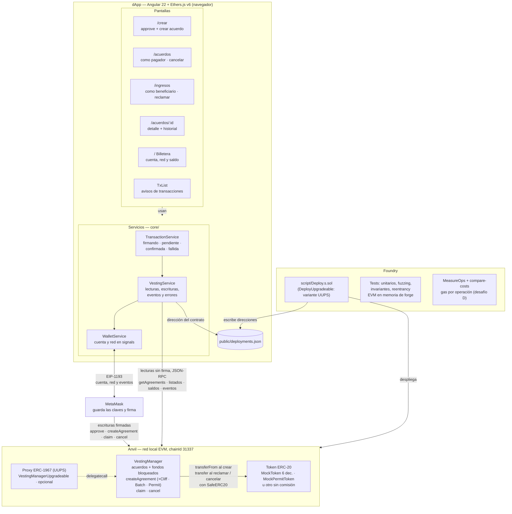

# Diagrama de componentes

> El diagrama que se usa en el documento de arquitectura es la imagen [`img/componentes.png`](img/componentes.png) (fuente editable: [`img/componentes.svg`](img/componentes.svg)). Este archivo es la misma información en formato Mermaid, que GitHub dibuja directamente.

## Componentes

| Componente | Responsabilidad |
|---|---|
| **VestingManager** | Un solo contrato para todos los acuerdos (`mapping(id => Agreement)`). Recibe y bloquea los fondos, calcula lo devengado y ejecuta reclamos y cancelaciones. Emite `AgreementCreated`, `Claimed` y `AgreementCancelled` |
| **Token ERC-20** | Medio de pago. En local es `MockToken` (6 decimales, `mint` abierto), pero el contrato acepta cualquier ERC-20 sin comisión por transferencia |
| **Deploy.s.sol** | Despliega los tokens de prueba y el VestingManager, y deja las direcciones en `frontend/public/deployments.json` |
| **VestingManagerUpgradeable** | Variante UUPS del VestingManager detrás de un proxy ERC-1967 (desafío opcional B). Reutiliza toda su lógica; `DeployUpgradeable.s.sol` la despliega |
| **MockPermitToken** | Token de prueba con soporte EIP-2612, para el flujo de creación con una sola transacción (desafío opcional E) |
| **MeasureOps + compare-costs** | Ejecutan las operaciones relevantes y calculan su gas y costo por red (desafío opcional D) |
| **Tests** | Corren en la EVM en memoria de forge, no en Anvil. Manejan el tiempo con `vm.warp` y usan tokens maliciosos (`ReentrantToken`, `FeeToken`) |
| **MetaMask** | Guarda las claves y firma. La dApp nunca ve una private key |
| **WalletService** | Conecta la billetera, guarda la cuenta y la red en signals, y escucha `accountsChanged` y `chainChanged` |
| **VestingService** | Única pieza que habla con los contratos: lecturas, escrituras, historial a partir de eventos y traducción de errores al español. Usa el provider y el signer de `WalletService` |
| **TransactionService** | Sigue cada transacción hasta que se confirma o falla, y avisa a las pantallas para que recarguen. Usa `VestingService` para traducir los errores |
| **Pantallas** | `/crear`, `/acuerdos`, `/ingresos` y `/acuerdos/:id` usan los tres servicios. La Billetera usa solo `WalletService`, y `TxList` solo `TransactionService` |
| **deployments.json** | Une el deploy con la dApp: la dirección del contrato no está escrita en el código |

## Cómo leer las flechas

- **Lecturas:** van directo de la dApp al nodo, sin firma ni gas. Incluyen `getAgreements`, los listados, los saldos del token y los eventos (`queryFilter`) que arman el historial.
- **Escrituras:** pasan por MetaMask, que las firma y las envía. Son `approve` sobre el token, y `createAgreement`, `claim` y `cancel` sobre el VestingManager.
- **VestingManager → Token:** el único lugar donde se mueven fondos, siempre con SafeERC20.
- **Servicios:** las flechas internas indican dependencia. `TransactionService` usa `VestingService`, que usa `WalletService`.
